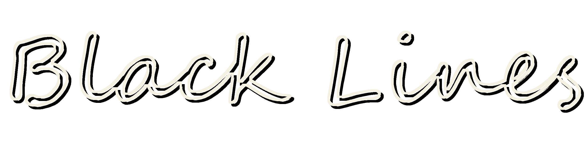
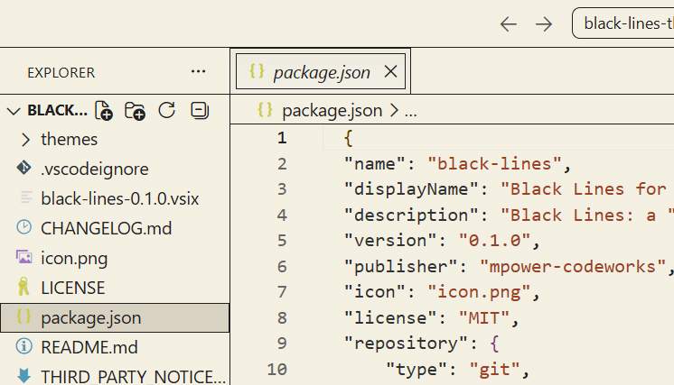
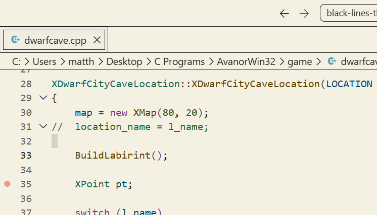
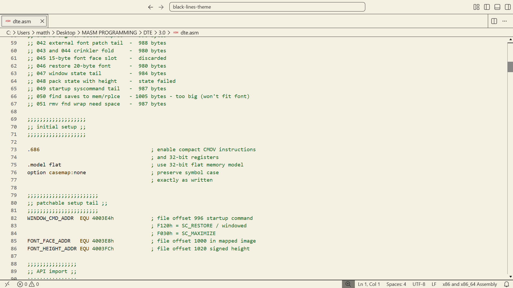
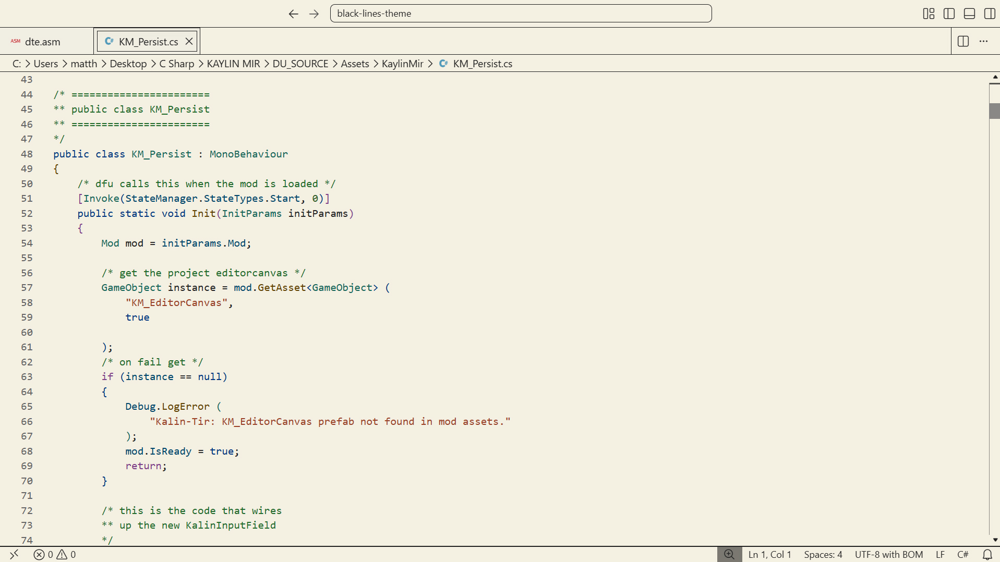

<!---->


<!--Black Lines is a light, high-contrast VS Code color 
theme using a mild ivory background and black borders.-->
𝖡𝗅𝖺𝖼𝗄 𝖫𝗂𝗇𝖾𝗌 𝗂𝗌 𝖺 𝗅𝗂𝗀𝗁𝗍, 𝗁𝗂𝗀𝗁-𝖼𝗈𝗇𝗍𝗋𝖺𝗌𝗍 𝖵𝖲 𝖢𝗈𝖽𝖾 𝖼𝗈𝗅𝗈𝗋 
𝗍𝗁𝖾𝗆𝖾 𝗎𝗌𝗂𝗇𝗀 𝖺 𝗆𝗂𝗅𝖽 𝗂𝗏𝗈𝗋𝗒 𝖻𝖺𝖼𝗄𝗀𝗋𝗈𝗎𝗇𝖽 𝖺𝗇𝖽 𝖻𝗅𝖺𝖼𝗄 𝖻𝗈𝗋𝖽𝖾𝗋𝗌.

<br><br>

<!--
Its syntax colors are based on VS Code's built-in
**Default High Contrast** theme.
-->
𝖨𝗍𝗌 𝗌𝗒𝗇𝗍𝖺𝗑 𝖼𝗈𝗅𝗈𝗋𝗌 𝖺𝗋𝖾 𝖻𝖺𝗌𝖾𝖽 𝗈𝗇 𝖵𝖲 𝖢𝗈𝖽𝖾'𝗌 𝖻𝗎𝗂𝗅𝗍-𝗂𝗇
𝖣𝖾𝖿𝖺𝗎𝗅𝗍 𝖧𝗂𝗀𝗁 𝖢𝗈𝗇𝗍𝗋𝖺𝗌𝗍 𝗍𝗁𝖾𝗆𝖾.
<br><br>
𝖲𝖾𝖾 "𝖱𝖾𝗅𝖾𝖺𝗌𝖾𝗌" 𝗈𝗇 𝗍𝗁𝖾 𝗋𝗂𝗀𝗁𝗍 𝖿𝗈𝗋 𝗍𝗁𝖾 𝖻𝗂𝗇𝖺𝗋𝗒.
<br><br>
```
- Background:         `#F4F0E2`
- Accent and borders: `#1F1F1F`
- Interface text:     `#202020`
- Selection:          `#D8D2C2`
- Scrollbar:          `#8A8886`
```
<table>
    <tr>
        <td align="left" width="50%" valign="top">
            <br>
        </td>
        <td align="left" width="50%" valign="top">
            <br>
        </td>
    </tr>
    <tr>
        <td align="left" width="50%" valign="top">
            <br>
        </td>
        <td align="left" width="50%" valign="top">
            <br>
        </td>
    </tr>
</table>

𝖳𝗁𝖾 𝗈𝗋𝗂𝗀𝗂𝗇𝖺𝗅 𝗌𝗒𝗇𝗍𝖺𝗑-𝖼𝗈𝗅𝗈𝗋 𝗋𝗎𝗅𝖾𝗌 𝗐𝖾𝗋𝖾 𝗍𝖺𝗄𝖾𝗇 𝖿𝗋𝗈𝗆 𝖬𝗂𝖼𝗋𝗈𝗌𝗈𝖿𝗍'𝗌 𝖵𝖲 𝖢𝗈𝖽𝖾 *𝖣𝖾𝖿𝖺𝗎𝗅𝗍 𝖧𝗂𝗀𝗁 𝖢𝗈𝗇𝗍𝗋𝖺𝗌𝗍* 𝗍𝗁𝖾𝗆𝖾 (`𝗁𝖼_𝖻𝗅𝖺𝖼𝗄.𝗃𝗌𝗈𝗇`), 𝖽𝗂𝗌𝗍𝗋𝗂𝖻𝗎𝗍𝖾𝖽 𝗎𝗇𝖽𝖾𝗋 𝗍𝗁𝖾 𝖬𝖨𝖳 𝖫𝗂𝖼𝖾𝗇𝗌𝖾. 𝖲𝖾𝖾 `𝖳𝖧𝖨𝖱𝖣_𝖯𝖠𝖱𝖳𝖸_𝖭𝖮𝖳𝖨𝖢𝖤𝖲.𝗆𝖽`.

## ⓜⓟⓞⓦⓔⓡ-ⓒⓞⓓⓔⓦⓞⓡⓚⓢ
